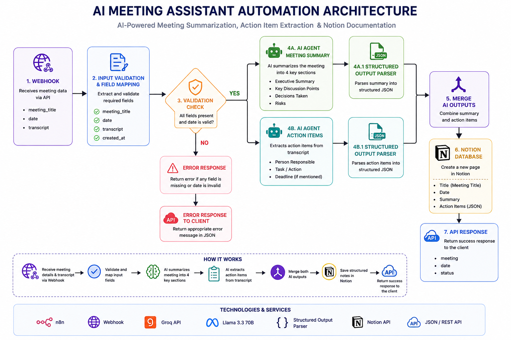
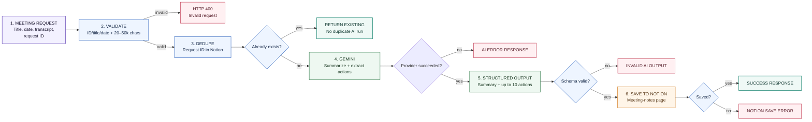

# AI Meeting Notes & Action Items — Architecture

**Validate a transcript submission, ask Gemini for structured notes and action items, validate shape, and save the result to Notion.**

## 1. Workflow at a glance

## 2. Input and output

| Input | Generated output |
|---|---|
| Request ID, meeting title, ISO date, transcript (20–50,000 characters) | Summary with executive summary, discussion points, decisions, risks; up to 10 action items with person/task/deadline; Notion page |

There is **no human approval step** in the supplied workflow: schema-valid AI output is saved automatically. Schema validation does not establish factual accuracy or confirm that actions/owners were agreed.

## 3. Services used

`n8n` webhook and validation · `Google Gemini` summary/action extraction · `Notion` duplicate lookup and page storage.

## 4. Privacy and security notes

- Source webhook has no authentication configured. Secure it before accepting real transcripts.
- Transcripts may include confidential or personal data and are sent to Gemini, then generated notes are stored in Notion. Review consent/notice, provider terms, access, retention, and deletion.
- Prompt-injection instructions and a JSON schema do not guarantee accurate or safe output. Add human review before distribution/action.
- Protect the Notion database and n8n execution data. Use synthetic transcripts for demos.

> **Portfolio output:** 17 nodes and 10 connection groups. Do not use real meeting content in public demos.
